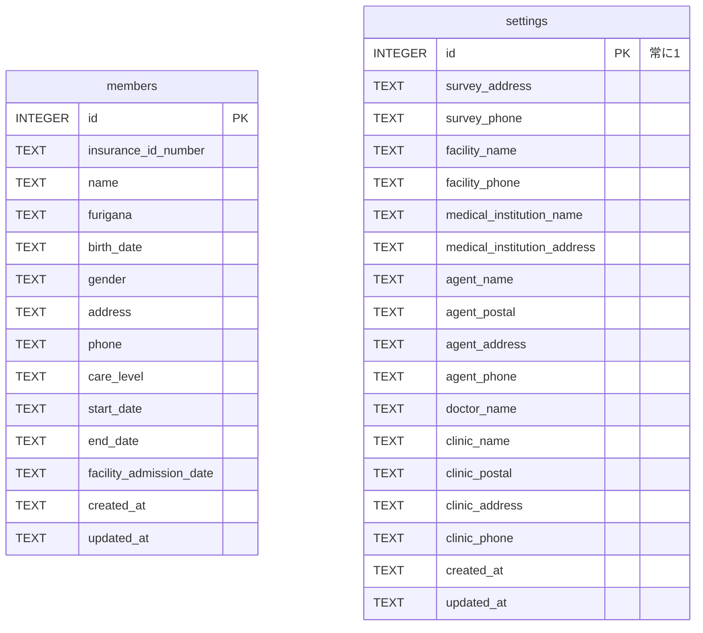

# DB設計書（SQLite）

- **対象**：Windows Tauri デスクトップアプリ
- **前提**：[ADR-002](adr/ADR-002-sqlite-storage.md)（SQLite採用）、[ADR-003](adr/ADR-003-sqlite-access-encryption.md)（Rustのコマンド経由・rusqlite・アプリでの暗号化なし）
- **作成日**：2026-11-06

## 1. 方針

| 項目 | 方針 |
|---|---|
| アクセス | Rust側（rusqlite）からのみ。画面（JS）はSQLを持たない |
| 列名 | フロントエンドの名前を snake_case にしたもの。受け渡しの型で `#[serde(rename_all = "camelCase")]` を使って変換する |
| 日付 | DBでは1列（TEXT、`YYYY-MM-DD`）。画面・PDF・受け渡しの型は年・月・日の3項目のまま。変換はRust側で行う |
| 空の値 | 文字列の項目は空文字 `''`。日付が未入力のときは `NULL` |
| 作成日時・更新日時 | `created_at` / `updated_at`。日本時間（例：`2026-11-06T13:47:00+09:00`）。値はRust側で自動で入れる |
| 申請年月日 | 保存しない（PDFを作るたびに入力する） |
| 暗号化 | アプリでは行わない（端末のBitLockerとWindowsのログインで保護する） |

## 2. ER図



2つのテーブルに関連はない。共通設定はPDFを作るときに利用者データと組み合わせて使う。

## 3. テーブル定義

### 3.1 members（利用者）

| 列名 | 型 | 必須 | 初期値 | 説明 |
|---|---|---|---|---|
| `id` | INTEGER | ○ | 自動採番 | 主キー |
| `insurance_id_number` | TEXT | ○ | `''` | 被保険者番号 |
| `name` | TEXT | ○ | なし | 氏名（空は不可） |
| `furigana` | TEXT | ○ | `''` | フリガナ |
| `birth_date` | TEXT | | `NULL` | 生年月日 |
| `gender` | TEXT | ○ | `''` | 性別（`''` / `男` / `女`） |
| `address` | TEXT | ○ | `''` | 住所 |
| `phone` | TEXT | ○ | `''` | 電話番号 |
| `care_level` | TEXT | ○ | `''` | 介護度（`''` / `要支援1`〜`要支援2` / `要介護1`〜`要介護5`） |
| `start_date` | TEXT | | `NULL` | 認定開始日 |
| `end_date` | TEXT | | `NULL` | 認定終了日 |
| `facility_admission_date` | TEXT | | `NULL` | **施設入所日**（利用者が施設に入所した日） |
| `created_at` | TEXT | ○ | なし | 作成日時（日本時間） |
| `updated_at` | TEXT | ○ | なし | 更新日時（日本時間） |

### 3.2 settings（共通設定・1件のみ）

| 列名 | 型 | 必須 | 初期値 | 説明 |
|---|---|---|---|---|
| `id` | INTEGER | ○ | `1` | 主キー。常に1（1件だけにするため） |
| `survey_address` | TEXT | ○ | `''` | 調査先の住所 |
| `survey_phone` | TEXT | ○ | `''` | 調査先の電話番号 |
| `facility_name` | TEXT | ○ | `''` | 施設名 |
| `facility_phone` | TEXT | ○ | `''` | 施設の電話番号 |
| `medical_institution_name` | TEXT | ○ | `''` | **医療機関名** |
| `medical_institution_address` | TEXT | ○ | `''` | **医療機関の住所** |
| `agent_name` | TEXT | ○ | `''` | 代理人の氏名 |
| `agent_postal` | TEXT | ○ | `''` | 代理人の郵便番号 |
| `agent_address` | TEXT | ○ | `''` | 代理人の住所 |
| `agent_phone` | TEXT | ○ | `''` | 代理人の電話番号 |
| `doctor_name` | TEXT | ○ | `''` | 主治医名 |
| `clinic_name` | TEXT | ○ | `''` | 主治医の医療機関名 |
| `clinic_postal` | TEXT | ○ | `''` | 主治医の医療機関の郵便番号 |
| `clinic_address` | TEXT | ○ | `''` | 主治医の医療機関の住所 |
| `clinic_phone` | TEXT | ○ | `''` | 主治医の医療機関の電話番号 |
| `created_at` | TEXT | ○ | なし | 作成日時（日本時間） |
| `updated_at` | TEXT | ○ | なし | 更新日時（日本時間） |

### 3.3 作成SQL（マイグレーション v1）

```sql
CREATE TABLE members (
  id                      INTEGER PRIMARY KEY AUTOINCREMENT,
  insurance_id_number     TEXT NOT NULL DEFAULT '',
  name                    TEXT NOT NULL CHECK (trim(name) <> ''),
  furigana                TEXT NOT NULL DEFAULT '',
  birth_date              TEXT CHECK (birth_date IS NULL OR date(birth_date) IS birth_date),
  gender                  TEXT NOT NULL DEFAULT '' CHECK (gender IN ('', '男', '女')),
  address                 TEXT NOT NULL DEFAULT '',
  phone                   TEXT NOT NULL DEFAULT '',
  care_level              TEXT NOT NULL DEFAULT '' CHECK (care_level IN (
                            '', '要支援1', '要支援2',
                            '要介護1', '要介護2', '要介護3', '要介護4', '要介護5')),
  start_date              TEXT CHECK (start_date IS NULL OR date(start_date) IS start_date),
  end_date                TEXT CHECK (end_date IS NULL OR date(end_date) IS end_date),
  facility_admission_date TEXT CHECK (facility_admission_date IS NULL
                                      OR date(facility_admission_date) IS facility_admission_date),
  created_at              TEXT NOT NULL,
  updated_at              TEXT NOT NULL
);

CREATE TABLE settings (
  id                          INTEGER PRIMARY KEY CHECK (id = 1),
  survey_address              TEXT NOT NULL DEFAULT '',
  survey_phone                TEXT NOT NULL DEFAULT '',
  facility_name               TEXT NOT NULL DEFAULT '',
  facility_phone              TEXT NOT NULL DEFAULT '',
  medical_institution_name    TEXT NOT NULL DEFAULT '',
  medical_institution_address TEXT NOT NULL DEFAULT '',
  agent_name                  TEXT NOT NULL DEFAULT '',
  agent_postal                TEXT NOT NULL DEFAULT '',
  agent_address               TEXT NOT NULL DEFAULT '',
  agent_phone                 TEXT NOT NULL DEFAULT '',
  doctor_name                 TEXT NOT NULL DEFAULT '',
  clinic_name                 TEXT NOT NULL DEFAULT '',
  clinic_postal               TEXT NOT NULL DEFAULT '',
  clinic_address              TEXT NOT NULL DEFAULT '',
  clinic_phone                TEXT NOT NULL DEFAULT '',
  created_at                  TEXT NOT NULL,
  updated_at                  TEXT NOT NULL
);
```

- `date(x) IS x` は、`2025-02-30` のような存在しない日付や、`2025-2-3` のようにゼロ埋めしていない形を拒否する。SQLiteは存在しない日付を別の日に直して返し、形が正しくない値には `NULL` を返すため、どちらも元の値と一致しない。`=` ではなく `IS` を使うのは、`NULL = x` が「不明」となりCHECK制約を通ってしまうため。
- CHECK制約は最後の守りであり、利用者に見せるエラーメッセージはRust側の入力チェック（5章）で出す。

## 4. 項目の対応表（IndexedDB・画面 → SQLite）

### 4.1 members

| IndexedDB・画面（今の名前） | 受け渡しの型（JS側の名前） | SQLite | 変換 |
|---|---|---|---|
| `id` | `id` | `id` | そのまま |
| `insuranceIdNumber` | `insuranceIdNumber` | `insurance_id_number` | そのまま |
| `name` | `name` | `name` | そのまま |
| `furigana` | `furigana` | `furigana` | そのまま |
| `birthYear` / `birthMonth` / `birthDay` | `birthYear` / `birthMonth` / `birthDay` | `birth_date` | 3項目 ⇄ 1列 |
| `gender` | `gender` | `gender` | そのまま |
| `address` | `address` | `address` | そのまま |
| `phone` | `phone` | `phone` | そのまま |
| `careLevel` | `careLevel` | `care_level` | そのまま |
| `startYear` / `startMonth` / `startDay` | `startYear` / `startMonth` / `startDay` | `start_date` | 3項目 ⇄ 1列 |
| `endYear` / `endMonth` / `endDay` | `endYear` / `endMonth` / `endDay` | `end_date` | 3項目 ⇄ 1列 |
| `institutionYear` / `institutionMonth` / `institutionDay` | **`facilityAdmissionYear` / `Month` / `Day`** | `facility_admission_date` | **名前の変更**＋3項目 ⇄ 1列 |
| （なし） | `createdAt` / `updatedAt`（読み取り専用） | `created_at` / `updated_at` | Rust側で自動で入れる |

### 4.2 settings

| IndexedDB・画面（今の名前） | 受け渡しの型（JS側の名前） | SQLite |
|---|---|---|
| `id`（`"singleton"`） | （なし） | `id`（常に1） |
| `surveyAddress` | `surveyAddress` | `survey_address` |
| `surveyPhone` | `surveyPhone` | `survey_phone` |
| `facilityName` | `facilityName` | `facility_name` |
| `facilityPhone` | `facilityPhone` | `facility_phone` |
| `institutionName` | **`medicalInstitutionName`** | `medical_institution_name` |
| `institutionAddress` | **`medicalInstitutionAddress`** | `medical_institution_address` |
| `agentName` | `agentName` | `agent_name` |
| `agentPostal` | `agentPostal` | `agent_postal` |
| `agentAddress` | `agentAddress` | `agent_address` |
| `agentPhone` | `agentPhone` | `agent_phone` |
| `doctorName` | `doctorName` | `doctor_name` |
| `clinicName` | `clinicName` | `clinic_name` |
| `clinicPostal` | `clinicPostal` | `clinic_postal` |
| `clinicAddress` | `clinicAddress` | `clinic_address` |
| `clinicPhone` | `clinicPhone` | `clinic_phone` |

### 4.3 名前の変更（`institution` の整理）

- 画面、`positions.json`、PDF描画、初期データの名前は、SQLiteへの移行（ロードマップ12〜15）で新しい名前に変える。
- `positions.json` は名前だけを変え、座標の値は変えない。変えた後にPDFを1枚出して目で確かめる。
- IndexedDB・バックアップv1から取り込むときは、古い名前を新しい名前に読み替える。この処理はロードマップ16で削除する。

### 4.4 日付の変換

| 方向 | 規則 | 例 |
|---|---|---|
| 画面 → DB | 3項目すべて入力済みなら `YYYY-MM-DD`（月・日はゼロ埋め）。すべて空なら `NULL` | `1937` `1` `12` → `1937-01-12` |
| DB → 画面 | 年・月・日に分け、月・日のゼロを外す（今の画面とPDFの表示に合わせる） | `1937-01-12` → `1937` `1` `12` |
| DB → 画面（未入力） | 3項目とも `''` | `NULL` → `''` `''` `''` |

### 4.5 バックアップJSON（caredoc-backup v1）からの取り込み

1. 08と同じ検証を行う（形式、版、id、未知の項目、文字列の型、空の氏名）。
2. 古い名前を新しい名前に読み替え、日付を4.4の規則で1列にする。
3. 5章の入力チェックを行う。1件でも通らなければ、全件を取り込まずに中止し、どの利用者のどの項目かを表示する。
4. `id` はバックアップの値をそのまま使う。
5. `created_at` と `updated_at` には、取り込んだ時刻を入れる。
6. 全件を1つのトランザクションで書き込む。

**注意**：今の画面は年だけの入力などを保存できるため、実際のデータに途中までの日付があると、3で止まる。その場合は、管理画面（IndexedDB版）で直してからバックアップし直す。

## 5. 入力チェック（Rust側のService）

| 項目 | ルール | エラーメッセージの例 |
|---|---|---|
| 氏名 | 前後の空白を除いて空でない | 氏名を入力してください。 |
| 性別 | `''` / `男` / `女` のどれか | 性別の値が正しくありません。 |
| 介護度 | `''` / 要支援1〜2 / 要介護1〜5 のどれか | 介護度の値が正しくありません。 |
| 日付4つ | 年・月・日をすべて入力するか、すべて空にする | 生年月日は年・月・日をすべて入力してください。 |
| 日付4つ | 実在する日付 | 生年月日が正しくありません。 |
| 日付4つ | 年は今の画面の選択肢に合わせ、今年の120年前〜2年後 | 生年月日の年が範囲外です。 |
| 認定期間 | 開始日と終了日が両方あるとき、開始日 ≦ 終了日 | 認定終了日が開始日より前になっています。 |
| 文字列すべて | 前後の空白を除いて保存する（今の管理画面と同じ） | — |
| 文字列すべて | 長さの上限（目安：住所200文字、そのほか100文字） | 住所が長すぎます。 |

文字数の上限は、PDFの印字欄に入りきるかどうかとは別のものとする（印字欄の確認はロードマップ17・18で扱う）。

## 6. マイグレーション（テーブル構造の変更手順）

- 版の管理には SQLite の `PRAGMA user_version` を使う（v1 = 3.3の作成SQL）。
- マイグレーションのSQLは、Rustのコードに版ごとに埋め込む（`migrations/0001_init.sql` などを `include_str!` で読み込む）。
- アプリ起動時に次の順で行う。
  1. `user_version` を読む
  2. アプリが持つ版より古ければ、**DBファイルを `caredoc_before_v{新しい版}.sqlite3` としてコピーしてから**、足りない版を順に実行する
  3. 全版を1つのトランザクションで実行し、最後に `user_version` を更新する。失敗したら元に戻し、画面にエラーを表示する
- `user_version` がアプリの版より新しいとき（古いアプリで新しいDBを開いたとき）は、DBに触れずにエラーを表示する。
- 列を足すときは `ALTER TABLE ... ADD COLUMN` を使う。列の削除や型の変更が必要なときは、新しいテーブルを作ってデータを移し、入れ替える。

## 7. DBファイル

| 項目 | 内容 |
|---|---|
| 保存場所 | Tauriのアプリデータ用フォルダ（`app_data_dir`）。Windowsでは `%APPDATA%\jp.caredoc.lib\` |
| ファイル名 | `caredoc.sqlite3` |
| 接続時の設定 | `PRAGMA foreign_keys = ON;`（今は外部キーなし。将来のため） |
| ジャーナル | 既定（DELETE）のまま。ファイルが1つで済み、バックアップのコピーがしやすい |
| 同時接続 | Rust側で接続を1つだけ持つ（`Mutex<Connection>`） |

## 8. 初期データ

- 今のIndexedDB版は、利用者が0件になると初期データ7名を入れ直す（`seedIfEmpty()`）。SQLite版ではこの動きをやめる。
- **開発版（`bunx tauri dev`、`cfg!(debug_assertions)` が真）でDBを新しく作ったときだけ**、初期データ7名と共通設定1件を入れる。
- **配布するビルド版には初期データを入れない。** 初回起動時は利用者0件から始まり、管理画面に「利用者が登録されていません。『＋新規登録』から追加してください。」と表示する。
- どちらの版でも、0件になった後に入れ直すことはしない。
- IndexedDBからデータを移すときは、初期データを入れずに移行データだけを使う。
- ビルド版で動作を確かめるときは、テスト用のバックアップ（`docs/impl/test-data/OK_caredoc-backup_seed.json`）を読み込んで7名を入れる。

## 9. 対象外

- 暗号化（ADR-003で見送り）
- 担当者アカウント、監査記録、申請履歴（ADR-002の将来機能）
- 実装（ロードマップ12以降）
